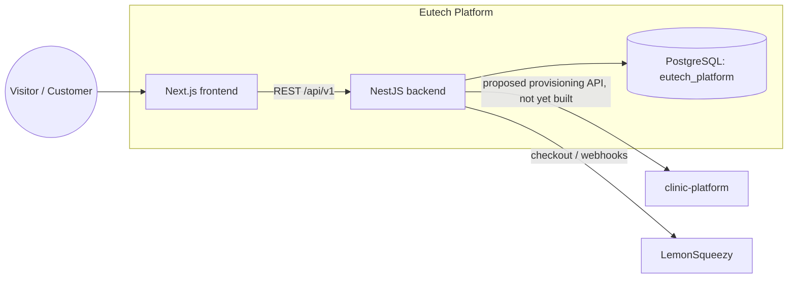

# Architecture

## Stack decision and deviation from the original brief

`EUTECH_CLAUDE_MASTER_INSTRUCTION.md` specifies Laravel 12 + Sanctum for the backend and Vue 3 + Vite for the frontend, reusing the `nextleap-backend`/`nextleap-frontend` prototypes. During the approved planning discussion for this repository, the product owner explicitly chose to deviate from that and instead match `clinic-platform`'s stack:

- **Backend**: NestJS 11 + Prisma + PostgreSQL, JWT access tokens with rotated refresh tokens in HttpOnly cookies, Node's built-in `crypto.scrypt` for password hashing (see note below), `@nestjs/throttler` rate limiting, `class-validator` DTOs.
- **Frontend**: Next.js (App Router) + React instead of Vue, `next-intl` for EN/ZH instead of vue-i18n.
- **Tooling**: pnpm workspaces + Turborepo, matching `clinic-platform`'s own tooling.

**Rationale**: `clinic-platform` is a separate, read-only repository that Eutech provisions workspaces in but does not own. It has no shared-session mechanism today (JWT + rotated refresh cookies, not Sanctum sessions). Matching Eutech's stack to clinic-platform's does not unlock real single sign-on immediately — clinic-platform would still need its own new code to accept an externally-issued token, and that is out of scope for this repository — but it means both systems speak the same token format and ecosystem, so a future trust relationship is a natural extension rather than a bridge between two different frameworks and languages.

**Password hashing note**: clinic-platform uses argon2, which requires native compilation via node-gyp. The local development machine used to build this repository has no C++ build toolchain (Visual Studio Build Tools) installed, and installing one is a heavy, unrelated system change outside this task's scope. Node's built-in `crypto.scrypt` was used instead — a memory-hard KDF with no native dependency. This is a pragmatic environment-driven deviation, not a security downgrade; revisit if/when the deployment environment can reliably build argon2's native addon.

**Consequence**: `nextleap-backend` (Laravel) and `nextleap-frontend` (Vue) contributed no reusable code to this repository — different language and framework entirely. Their value was captured as documented lessons in `LEGACY_ASSESSMENT.md` (weak password policy, broken Sanctum guard aliasing, non-idempotent webhooks, plaintext-password log leakage, hardcoded plan query-strings, `alert()`-based errors, console-logged tokens) so the same mistakes are not repeated here.

## System overview

- The frontend is a public marketing site (Phase 1) that will grow into the authenticated Eutech Account customer portal and Eutech Admin (Phases 2, 5).
- The backend owns all Eutech commercial data (see `DATA_MODEL.md`) and never stores clinical data.
- `clinic-platform` remains a separate system Eutech talks to only through the proposed provisioning contract (see `PROVISIONING_CONTRACT.md`) — never through direct database access.

## Data ownership boundary

Eutech's Postgres database (`eutech_platform`) contains only commercial data: accounts, organizations, subscriptions, entitlements, onboarding, and opaque references (`workspaceId`, `accessUrl`) to a clinic-platform tenant. It never contains patients, visits, consultations, prescriptions, medicines, or inventory — those remain exclusively inside clinic-platform's own database, which Eutech never queries directly.

## Local databases

Two isolated PostgreSQL databases were created for this repository, owned by a new `eutech_user` role, entirely separate from `clinic-platform`'s `clinic_user`/`clinic_platform` database:

- `eutech_platform` — development database
- `eutech_platform_test` — reserved for automated test runs

See `LOCAL_SETUP_WINDOWS.md` for connection details.
